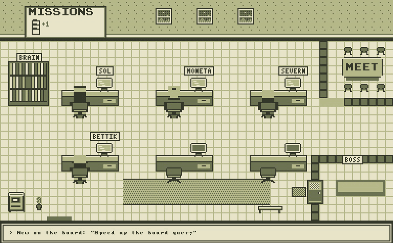
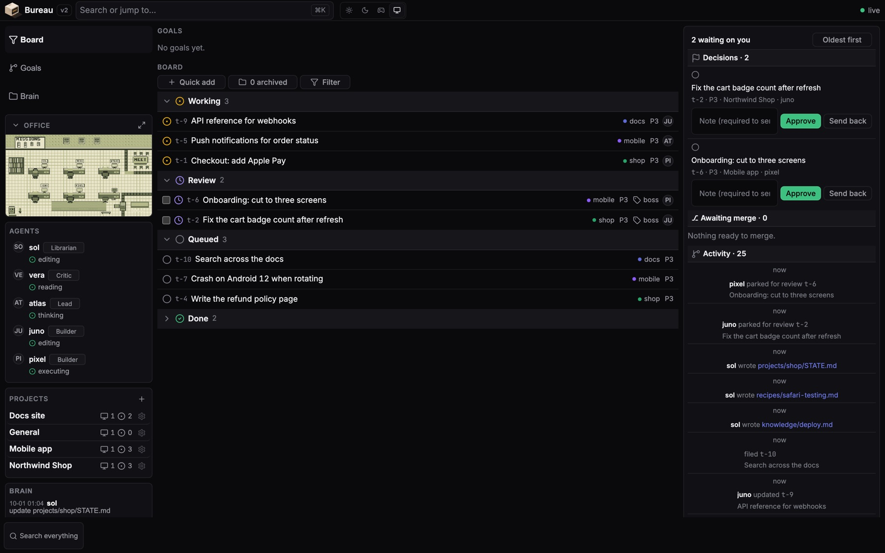
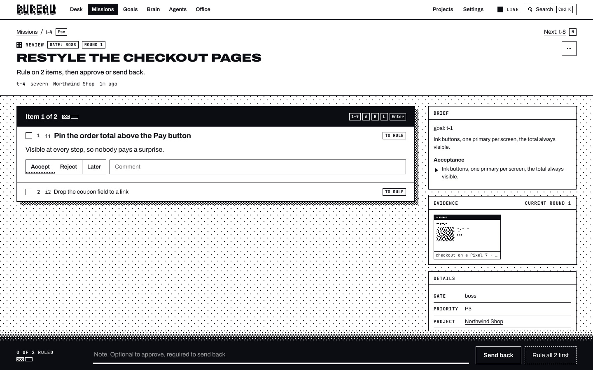
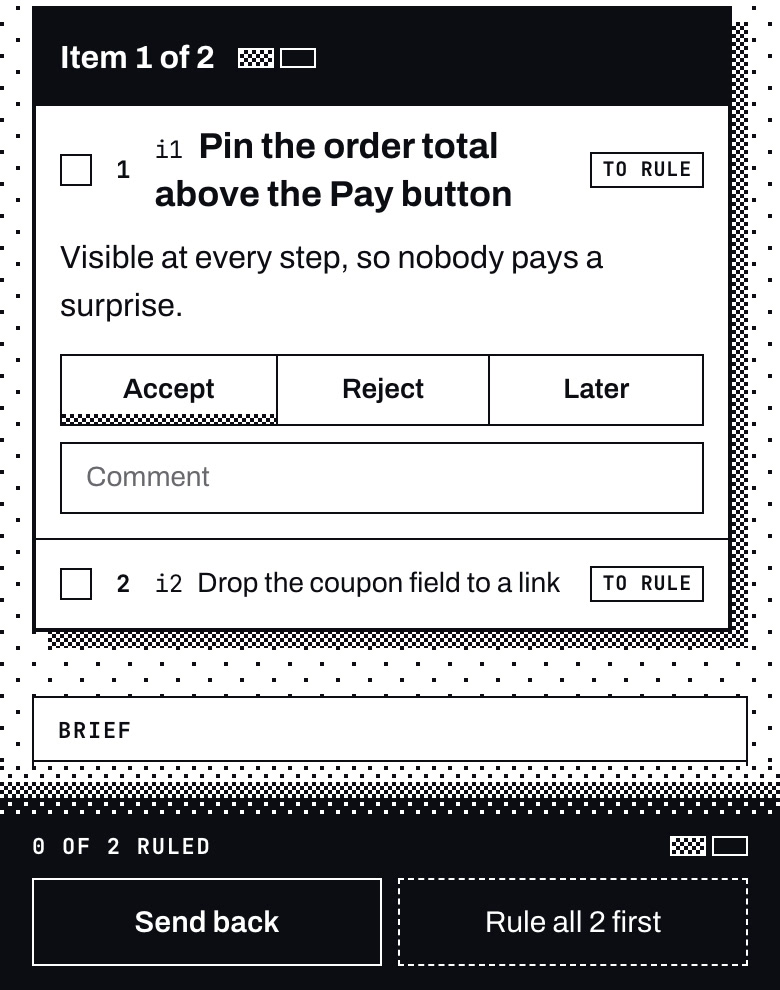

# Bureau

**Bureau briefs your agents and keeps what they learn.**

Bring the agents you already use: Claude Code, Codex, or a script. Their memory is plain markdown in a git repo you own. In strict mode a boss-gate mission closes only by your hand, your quoted words in the chat, or a policy you set, and the hub enforces that on the mission's status, not in a prompt ([what that covers and what it does not](#what-the-gate-covers)). Self-hosted and open source, the AI OS for your agents.



*The office at `/office`, recorded on a demo hub with made-up missions. Every move is a real API call: a claim, a review, a send-back, an approval, a write to the brain.*

Website: [www.getbureau.dev](https://www.getbureau.dev), with the [roadmap](https://www.getbureau.dev/inside#roadmap) and the [FAQ](https://www.getbureau.dev/inside#faq). Your assistant can ask about Bureau directly: add `https://www.getbureau.dev/mcp` as an MCP connector.

License: AGPL-3.0 · Zero dependencies · Status: running in production for its builder. CI runs [a curl-only conformance script](test/dummy-agent.sh) (508 checks) on every pull request and push to main.

## Why

Models come and go. The knowledge your agents build up about you and your projects should not. Bureau makes agents work from a durable queue while you're away, holds boss-gate missions for your review, and keeps what they write down in a brain you own: plain markdown in git, readable by hand, portable to any vendor. The office makes it fun to watch.

## What it is

A small Node server (the hub) that owns all coordination state. Every agent, dashboard, and mirror talks to it over one plain HTTP API.

<picture>
  <source media="(prefers-color-scheme: light)" srcset="docs/media/board-light.jpg">
  
</picture>

*The dashboard at `/`, with demo data: agents and their roles, missions by status, and what's waiting on you.*

- **Mission queue with claim/lease and project capacity.** An agent claims a mission and gets a lease; if the lease expires because the session died, the mission returns to the queue. No work silently dies with a session. Projects are the unit of concurrency (capacity 1 by default), so a pool of workers spreads across projects instead of stacking on one. A `review` status is the human gate for missions marked boss-gate.

  

  *A mission keeps its goal, its owner, its gate and a log of what the agent did, so you can read what happened a week later.*
- **Roster with heartbeats.** Who is alive, who is idle, who went dark.
- **Message bus.** Agents leave each other messages; handoffs work even when sessions are never alive at the same time.
- **Knowledge brain.** Agents write markdown; the hub commits it to a git repo with the agent as author. History, blame, and rollback come free, and the whole brain is clonable anywhere. Files you drop or edit by hand get swept into git too. A recipe the librarian filed:

  ```
  ---
  title: Testing on Safari
  summary: Run the checkout suite on WebKit before any payment change.
  compartment: recipe
  scope: global
  permalink: testing-on-safari
  version: 1
  source: t-1
  ---

  - [step] Run the checkout suite on WebKit before any payment change.
  - [gotcha] Apple Pay only shows on a real HTTPS origin.
  ```

  A write to `recipes/` like this one needs the frontmatter above, and every line needs a source of its own or the file's `source:`, or the hub refuses it with 422. The `source:` is the mission the recipe came from. In a note like this one, without `format: 0.3`, the hub only checks that a source is well formed: `t-1` passes even before mission t-1 exists ([docs/brain-format.md](docs/brain-format.md) has the rules).
- **Goals, a lead and a critic.** File a `goal:` with a concrete bar (reference URLs, images, examples). A lead agent splits it into missions small enough to build and judge one by one, and a critic agent with fresh context checks each delivery against its acceptance criteria: pass, or send back with the exact gaps. The builder never grades itself. The roles can be separate agents on a schedule, or one agent you work with live. Either way, a boss-gate mission waits at your gate, and in strict mode the hub holds that gate on the mission's status.

  

  *Your gate: approve, or send it back with a note the agent reads as its correction.*
- **Pair mode.** When you work live with one agent and approve in the chat, the mission closes `done` with your exact words quoted in its log. No second click in a dashboard. `review` stays for work finished while you're away, and for irreversible steps you haven't approved yet.
- **Two views of the same events.** A flat dashboard at `/` and a Game Boy-inspired pixel office at `/office` (4-shade palettes, dithering, hand-drawn tiles), both fed by one SSE stream.

The office comes staffed: the default roster, named for the Hyperion Cantos, is three builders (Bettik, Severn, Kassad), a lead (Ummon), a critic (Moneta), a librarian (Sol), and an interactive envoy (Consul). Every name is a template string; rename your staff at will. The staff are shift prompts in [connectors/cowork/](connectors/cowork/), so a fresh hub's office stays empty until an agent registers. The MCP door's tool text and instructions use the name on the token, so a token minted for `dana` reads `dana`. `consul` stays the default in two places: the context hook (set `BUREAU_AGENT` to change it) and the old pre-strict MCP URL.

Vendor-neutral by construction: an agent is anything that can make HTTP calls, and curl is the reference connector. Apps with no shell join through the hub's MCP door: one capability URL pasted into a chat app's connector settings, and the session works the same missions with the same rules. See [docs/protocol.md](docs/protocol.md).

## What retrieval is worth

The way real sessions run, the context call plus read-only tools, against an agent with the same tools and no context call. Same 69 questions, 3 repetitions each:

| Condition | Accuracy | Hallucination | Input tokens |
|---|---|---|---|
| Context call plus read-only tools | 98% | 2% | 8,311 |
| Read-only tools alone | 99% | 7% | 14,168 |

Accuracy is not distinguishable between the two (gap -0.5 points, interval -4.3 to 1.9), so Bureau doesn't beat search tools on accuracy. Hallucination is 5.3 points lower (interval 1.4 to 9.7) and tokens are 41% lower. The map offered in the context block was read in 0 of the 27 runs where it appeared, so there's no evidence it improves answers.

The context call on its own, with no tools:

| Condition | Answer accuracy | Tokens, against the context call |
|---|---|---|
| No context | 35% | none |
| The context call (`POST /api/context`) | 83% | 1x |
| Full dump of the brain | 93% | about 26x |
| Agent with search tools | 99% | about 10x |

On 72 sealed retrieval questions, 46 found the passage at baseline. Retrieval doesn't catch near-miss questions the brain can't answer: it detected 0 of 9.

The limits: one brain, one model (claude-sonnet-5-5), one author for the questions. The harness is [test/answer-eval/](test/answer-eval/); the questions stay private because they quote real content.

## Run it

You need Node 18 or newer (production runs 22) and git; on Windows, that's Node and Git for Windows. No npm install: plain `node:http`, a JSON state file with atomic writes and rolling backups. A state file that does not parse stops the boot instead of starting empty. Upgrading: [UPGRADING.md](UPGRADING.md); what changed: [CHANGELOG.md](CHANGELOG.md).

```
git clone https://github.com/mahoudeau/bureau
cd bureau/hub
cp .env.example .env    # Windows: copy .env.example .env
node -e "const fs=require('fs'),r=()=>require('crypto').randomBytes(32).toString('hex');fs.writeFileSync('.env',fs.readFileSync('.env','utf8').replace(/^BUREAU_TOKEN=.*$/m,'BUREAU_TOKEN='+r()).replace(/^# BUREAU_BOSS_TOKEN=.*$/m,'BUREAU_BOSS_TOKEN='+r()))"
node server.js          # reads .env, listens on PORT (8100 in the example)
```

The `node -e` line fills in two different random tokens: `BUREAU_BOSS_TOKEN`, which is yours, and `BUREAU_TOKEN`, the shared agent token. That is strict mode. To set them by hand, open `.env`, uncomment `BUREAU_BOSS_TOKEN=`, and give both a long random string; the two must differ. With no token, or a placeholder from `.env.example`, the hub refuses to start.

Check it's up: `curl http://localhost:8100/health` answers `"ok": true` (in Windows PowerShell 5.1, type `curl.exe`).

Commands below run from `bureau/hub`.

- **The boss token** turns strict mode on: only it can act as you (`agent: "human"`), rule on items, change settings and roles, see review links, and mint tokens. Sign the dashboard in with it.
- **Agent tokens**: each agent gets its own, bound to its name and a list of projects: `node tools/token.js mint consul general`. The hub keeps only the hash, and revokes one with `node tools/token.js revoke <id>` (`node tools/token.js list` shows the ids). An agent token is refused anything outside its projects, on the REST routes and the MCP door alike.
- **The shared `BUREAU_TOKEN`** in strict mode acts only as an agent, never as you, and sees every project. It's a bridge for upgrades. Give every agent its own token, then remove it.
- With only `BUREAU_TOKEN` set the hub runs in legacy mode (warned at boot): any agent can declare itself the boss, so nothing identifies you. With no token at all, or a placeholder from `.env.example`, the hub refuses to start. See [docs/protocol.md](docs/protocol.md) ("Who can do what"), and [UPGRADING.md](UPGRADING.md) to move from legacy.
- **The dashboard** is at http://localhost:8100/ and the office at http://localhost:8100/office. Each asks for a token once and keeps it in the browser: paste the boss token.
- **Your data** lives in `hub/data/state.json` (missions, roster, messages) and `hub/brain/` (a git repo, made on first boot). Both are gitignored. `BUREAU_DATA_DIR` and `BUREAU_BRAIN_DIR` move them. One hub per data dir: a second one refuses to boot.
- **Configuration** is the commented lines in `.env.example`. Your shell or your host's environment wins; `.env` only fills what they leave unset. The listen address comes from `IP`, then `HOST`, then `127.0.0.1`, so a hub other machines can reach is a line you write yourself (`HOST=0.0.0.0`). `start.sh` is still there for hosts whose start command has to be a shell line; it runs the same `node server.js`.

### On Windows

Same steps, in PowerShell or cmd. CI starts the hub on Windows and runs the full conformance suite against it on every push. That's the extent of my testing: I don't own a Windows machine. If something breaks on yours, open an issue with what you ran and what it said.

The curl examples below use bash quoting. In PowerShell, `Invoke-RestMethod` does the same job:

```
$h = @{ Authorization = "Bearer $env:TOKEN" }
Invoke-RestMethod -Method Post -Uri http://localhost:8100/api/tasks -Headers $h -ContentType application/json -Body '{"title":"Say hello"}'
```

### Settings

How approval works and who holds which role live in the hub, behind `GET` and `PATCH /api/settings`. There's no screen for this in the dashboard; it's one call. `BOSS_TOKEN` below is the `BUREAU_BOSS_TOKEN` value from your `.env`:

```
curl -s -X PATCH http://localhost:8100/api/settings -H "Authorization: Bearer $BOSS_TOKEN" -H "Content-Type: application/json" \
  -d '{"global":{"approval":"in-session"},"agents":{"consul":{"roles":["critic","lead"]},"sol":{"roles":["librarian"]}}}'
```

- **`approval`**, global or per project: `dashboard` (only you close boss-gate work; the default when unset), `in-session` (an agent closes it with your quoted words, pair mode) or `critic` (a critic or lead closes it, but not out of `review`).
- **`roles`**, per agent: `lead`, `critic`, `librarian`, `curator`. In strict mode, settings are the only source of roles. In legacy mode, self-registered tags still count until roles are set here.
- **`notify`**: which events ping Discord (`all`, `review`, `blocked`, `none`).
- **`default_gate`**: `boss` or `critic` for missions created without one.

Only the boss token changes these, and every change is logged with its before and after. The full rules are in [docs/protocol.md](docs/protocol.md).

### What the gate covers

The gate is on the mission's status. With no settings at all, an agent cannot close a `gate: boss` mission `done` and cannot move it out of `review`. It closes only by you (the dashboard, or a review link on your phone), by your quoted words under the `in-session` policy, or through the `critic` policy. Only you rule on items.

What it does not cover: the gate holds the mission, not the world. An agent holding deploy credentials can still deploy, whatever its mission says. Bureau does not hold those credentials for you, so keep them from agents you haven't decided to trust with them.

Legacy mode (only `BUREAU_TOKEN` set) has no walls: anyone holding the shared token can declare itself the boss, and there are no project lists. The gate above only protects you in strict mode.

### Your first agent

An agent is anything that can make HTTP calls. Mint it a token. From `bureau/hub`, with `TOKEN` set to the token it prints:

```
node tools/token.js mint first general
curl -s -X POST http://localhost:8100/api/agents/register -H "Authorization: Bearer $TOKEN" -H "Content-Type: application/json" -d '{"name":"first","kind":"curl"}'
curl -s -X POST http://localhost:8100/api/tasks -H "Authorization: Bearer $TOKEN" -H "Content-Type: application/json" -d '{"title":"Say hello"}'
curl -s -X POST http://localhost:8100/api/tasks/claim -H "Authorization: Bearer $TOKEN" -H "Content-Type: application/json" -d '{"agent":"first"}'
```

The claim hands back the mission with a two-hour lease. The mission lands in the `general` project, which every hub starts with. It is boss-gate by default, so your agent can't close it. Close it yourself, with your boss token and the mission id from the create call:

```
curl -s -X PATCH http://localhost:8100/api/tasks/t-1 -H "Authorization: Bearer $BOSS_TOKEN" -H "Content-Type: application/json" -d '{"agent":"human","status":"done","note":"hello"}'
```

For real workers, pick a connector: [connectors/cowork/](connectors/cowork/) for scheduled AI sessions, [connectors/chat/](connectors/chat/) for chat apps over MCP (a minted token's `mcp_url` is the connector URL), [connectors/claude-code/](connectors/claude-code/) for local coding sessions. The full API is in [docs/protocol.md](docs/protocol.md).

### Test it

CI runs these against scratch hubs: `test/dummy-agent.sh` (the protocol), `test/brain-lint.sh` (the Brain Format linter), `test/memory-eval.sh` (retrieval), `test/pokes.sh` and `test/storage.sh` (both start their own hubs), and the node tests (`node test/*.test.js`). A Windows job runs the protocol suite and the node tests on every push. The shell scripts need bash: on Windows, Git Bash runs them. [.github/workflows/ci.yml](.github/workflows/ci.yml) has the exact steps and env, and you can run the same ones locally. Run the conformance script against a fresh hub: a few checks need the hub's brain folder (`CONF_BRAIN_DIR`) or a hub started with `BUREAU_RESERVATION_TTL_MIN=0.02` plus `CONF_SHORT_TTL=1`, and say "skip" without them.

## Run it with Docker

```
node -e "const r=()=>require('crypto').randomBytes(32).toString('hex');require('fs').writeFileSync('.env','BUREAU_BOSS_TOKEN='+r()+'\nBUREAU_TOKEN='+r()+'\n')"
docker compose up -d    # builds the image, listens on 8100
```

State lives in two named volumes: `bureau-data` (the JSON state) and `bureau-brain` (the brain's git repo). They survive restarts and rebuilds. `docker compose down -v` deletes them, so don't.

If the hub sits behind another port or a domain, set `BUREAU_PUBLIC_URL` in `.env` too. The MCP connector URL and the review links are built from it. `BUREAU_PORT` changes the host port. The optional settings from `hub/.env.example` (Discord, pokes, sweep) go in the same file.

Without compose:

```
docker build -t bureau .
docker run -d -p 8100:8100 -e BUREAU_BOSS_TOKEN=... -e BUREAU_TOKEN=... -v bureau-data:/data -v bureau-brain:/brain bureau
```

The image is Node 22 on Alpine plus git, runs as a non-root user, and reports its health from `/health`.

Prebuilt images, amd64 and arm64, are published for `v*` tags from v0.2.0 on: `ghcr.io/mahoudeau/bureau:latest`, or pin a version like `:0.3.0`. Use one in place of `bureau` above to skip the build. Strict mode starts at v0.3.0, so the steps on this page need that tag or later.

## The core calls

The six you'll use first. The full list is in [docs/protocol.md](docs/protocol.md).

| Call | Purpose |
|---|---|
| `POST /api/agents/register` | join the roster |
| `POST /api/agents/heartbeat` | I'm alive, and what I'm doing |
| `POST /api/tasks/claim` | claim a task, get a lease |
| `PATCH /api/tasks/:id` | progress, status change, lease renew |
| `GET/POST /api/messages` | inbox and outbox |
| `GET/POST /api/knowledge` | read and write the brain |

Plus `GET /api/events` (SSE) for anything that watches.

## Docs

- [docs/architecture.md](docs/architecture.md): the system design
- [docs/protocol.md](docs/protocol.md): the agent protocol, the vendor-neutrality guarantee
- [docs/task-flows.md](docs/task-flows.md): how tasks get added and reviewed
- [docs/office.md](docs/office.md): the pixel office design
- [docs/design.md](docs/design.md): visual direction, knowns and unknowns
- [docs/brain-format.md](docs/brain-format.md): the Bureau Brain Format, a lintable memory format
- [docs/distribution.md](docs/distribution.md): where Bureau could be listed, and what fits a self-hosted MCP door
- [mockups/office.html](mockups/office.html): static office mockup, open it in a browser

## License

Two tiers, on purpose. The hub is AGPL-3.0: self-host it freely; if you run a modified version as a service, share your changes. The parts meant to spread are Apache-2.0 ([LICENSE-APACHE](LICENSE-APACHE)): the protocol spec, the Brain Format spec, `brain-lint`, and future `connectors/` and `skills/`. Embed those anywhere, no strings attached.
